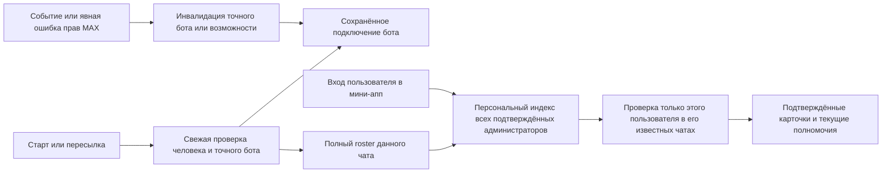

# Права ботов и администраторов при 10 000–50 000 подключений

Уточнённая реализация: постоянное положительное подтверждение бота; отключение fleet-таймера и старых плановых заданий; история администраторов через добавочный SQL-триггер; немедленный локальный каталог сохранённых чатов; проверка человека только для выбранной сущности; подписка на `bot_admin_permissions_changed`. SQL и Redis сохраняют существующие ограждения гонок. Проверка автора публикации остаётся независимой. Первоначальный полный список администраторов сохраняется одним roster-запросом при подключении.

Дата: 12 октября 2026. Статус: реализация `6e400014` развёрнута в production в составе
`4aa48ce88d5b3dd1f7ad3bafce398df6b31d60c5`, релиз
`release-20261012T223430Z-4aa48ce88d5b` от 13 октября 01:36:59 МСК.
Обновлены все 14 API-ролей, Mini App и Safety Desk; обе миграции персональной
истории администраторов применены. Локальные проверки и exact-SHA CI, включая
настоящие PostgreSQL/Redis и браузерные сценарии, прошли. Выкладка завершилась
строгими production smokes. Причина устранённого блокера readiness 503 и
результаты наблюдения записаны в [отчёте об инциденте](../incidents/2026-10-13-removal-mirror-readiness.md).
Процент экономии MAX-запросов и нагрузочные SLA этим наблюдением не доказаны.
План учитывает последовательно уточнённую владельцем модель подключения,
персональной проверки при входе и первоначального сохранения всех администраторов.

## Реализованная конфигурация

- Положительное подтверждение бота бессрочное. Старое поле expiry сохраняется для совместимости; оно больше не разрешает и не запрещает исполнение.
- Fleet scheduler не запускает проходы, а оставшиеся `scheduled_bot_access` и `binding_maintenance` завершаются без MAX-запросов. Проверка автора конкретной публикации сохраняет отдельные 15 минут.
- При подтверждённом подключении запрашивается полный состав администраторов точного бота. Только явно подтверждённые люди получают связи; неполный ответ не служит новым положительным доказательством.
- История хранится в `last_admin_confirmed_at` на access edge. SQL-триггер запоминает старый grant при отзыве, без массового backfill. Ранее потерянная история не выдумывается.
- Главная читает сохранённые `GRANTED` связи пользователя из базы без MAX-запросов и без фильтра по времени входа или сроку человеческого доказательства. Явный `USER_DENIED`/`BOT_DENIED` исключает карточку. История без положительной связи не выдаёт карточку; каталог не является разрешением на чтение настроек или действие.
- Массовая персональная перепроверка при входе также отключена: даже 100+ чатов не порождают 100 MAX-запросов. Idle-prefetch загружает только код; защищённые настройки запрашиваются при выборе сущности.
- Модерационные настройки сохраняют существующую свежую MAX-проверку перед чтением и изменением. Публик проверяет точного человека через свой процесс и отдельное приоритетное задание `selected_actor_access`, переиспользуя бессрочное доказательство бота. Повторные запросы объединяются; SQL-ожидание ограничено, результат человека переиспользуется не более 30 секунд и не раньше подписанной границы запуска. Старое доказательство не разрешает доступ при таймауте.
- Переход на экран настроек не ждёт завершения проверки. Уже загруженные в этой сессии значения видны сразу с временно выключенным управлением; первое открытие показывает каркас. После явного отказа управление недоступно, а при временной ошибке возможен повтор. Сохранение всегда защищено сервером. Лимиты MAX, worker concurrency и PostgreSQL pools не увеличиваются.
- `bot_admin_permissions_changed` принимается только с проверенной идентичностью получившего событие бота и монотонным временем. Неполное положительное событие не выдаёт прав; явное отрицательное событие отзывает их. Повторное подключение после отзыва остаётся явным действием администратора.
- Сохранены SQL epochs, membership/lifecycle fences, activation ceilings, защита незавершённых эффектов и независимое выполнение других чатов. Минимальная версия rollback reader поднята.
- Объединение разных одновременно входящих людей в один transport batch и отдельный распределённый fair scheduler не включены: используются существующие очереди и rate governor. Здесь нет обещания проверять тысячи личных чатов мгновенно; нагрузочные SLA ниже остаются целями измерения, а не результатами этого релиза.

Уточнение владельца после первой выкладки: список из 100+ чатов нельзя заново собирать по одному при каждом входе. Поэтому прежняя проверка всей персональной истории при открытии главной заменена проверкой только выбранного чата, как описано выше.

Остальные разделы сохраняют исходный архитектурный план и исходный production-срез.
Наблюдения «текущего кода» в них относятся к исходному SHA до реализации;
фактически выбранная конфигурация описана выше.

## 1. Предлагаемое решение

Принять следующую модель для шести ботов модерации и отдельно для Публика:

1. **Администратор подключает конкретного бота через `Старт` или пересылку.**
   Сервер свежими запросами подтверждает права человека и необходимые права бота.
2. **Подключение и подтверждённый набор возможностей бота сохраняются.**
   Возраст проверки сам по себе не отключает бота. Подтверждённое лишение прав,
   удаление, изменение возможностей или явное отключение обрабатываются отдельно.
3. **При подключении один раз загружается состав администраторов этого чата.**
   Для всех явно подтверждённых людей-администраторов сохраняются персональные
   связи с чатом. Каждому из них повторно подключать бота не требуется.
4. **При входе в мини-апп проверяется только вошедший человек**, только в чатах
   и каналах, где ранее было доказано его администраторство. Проверка выполняется
   заново для сессии, постепенно, с приоритетом открытой сущности.
5. **Действия от имени администратора имеют отдельную проверку полномочий.**
   Открытый вчера кабинет и когда-то сохранённая связь не разрешают сегодняшнюю
   публикацию. Автоматическая модерация сохраняет свои проверки иммунитета,
   настроек, текущего исполнителя и разрешённого действия.
6. **Регулярного полного обхода подключений ради продления прав нет.**
   Работа возникает от подключения, входа пользователя, события изменения прав,
   конкретной операции или обнаруженной проблемы. Очередь может работать в фоне,
   но её объём определяется этими причинами, а не общим размером каталога.

Это изменение модели авторизации, а не увеличение TTL или worker concurrency.
Безопасные ограничения прежних планов сохраняются; описанные здесь изменения
начинают действовать только после реализации, проверки и отдельной выкладки.

## 2. Что проверено в production

Read-only проверка 12 октября, 21:27–21:30 МСК (18:27–18:30 UTC).
Использованы штатный `doctor`, `health`, фиксированный
`postgres-audit publisher-access-census` после просмотра plain EXPLAIN,
разрешённые поля Docker metadata и агрегаты структурированных логов.
Сообщения в чаты и запросы прав в MAX для этой проверки не отправлялись.

| Наблюдение                           | Результат                                                                   | Ограничение вывода                                                                        |
| ------------------------------------ | --------------------------------------------------------------------------- | ----------------------------------------------------------------------------------------- |
| Релиз                                | `release-20261012T174413Z-41430f93c0f7`                                     | Моментный срез, не фиксация будущего состояния                                            |
| API source                           | `41430f93c0f7fe4de1794781849ea5b1945c4183`                                  | Checkout и API-компонент манифеста совпали                                                |
| Publisher image                      | `sha256:9ed63980de2674d735c4659e6f300d2798e484ae4134b41f82d8d8aec05319da`   | Работающий Publisher совпал с манифестом; полная аттестация 14 ролей здесь не выполнялась |
| Publisher bindings                   | 23 176 всего, 23 102 `ACTIVE`                                               | `ACTIVE` означает состояние записи подключения, а не доказанную активность публикаций     |
| Сохранённые положительные права бота | 1 236 admin/owner; из них 1 227 свежих и 9 истёкших                         | Остальные записи нельзя автоматически объявить разжалованными или исправными              |
| Полнота census                       | Без усечения, предел 50 000, один активный bot scope                        | Один снимок не доказывает покрытие всех сроков проверки                                   |
| Режим Publisher refresh              | `canary`, background 4 rps, общий предел токена 30 rps                      | Это реальные значения контейнера в момент чтения                                          |
| Readiness                            | БД/Redis доступны; lag около 1,2 с; режим `degrade`, восстановительное окно | HTTP 200 не означает завершение восстановления или запас мощности под пик                 |

Суммы census: legacy 20 852 ACTIVE / 1 101 confirmed / 1 093 fresh;
separated 2 250 ACTIVE / 135 confirmed / 134 fresh. Названия когорт относятся
к старой политике 30-минутного roster refresh, не к предлагаемой новой модели.

В логах Publisher, выданных за 21:15–21:30 МСК, обнаружены:

- 1 621 попытка `scheduled_bot_access`, 1 615 выполненных стадий bot probe;
- 1 057 попыток `binding_maintenance`, 1 054 стадии roster;
- у 806 попыток maintenance возраст очереди превышал 10 минут;
- 111 попыток `webhook_observed` со стадиями bot/catalog/roster;
- 10 повторных `stale_user_access`, все с исключением и возрастом более 10 минут;
- 15 отчётов сканера; в этом отрезке не наблюдалось завершения roster-init cursor.

Это агрегаты **попыток и стадий из опубликованных окон**, а не уникальных чатов,
HTTP-запросов или успешных выдач доступа. Хвост чтения логов не усечён, но первые
опубликованные окна могут начинаться до границы выборки. Их нельзя делить на
900 секунд для точного rps, суммировать повторные часовые obligation-отчёты или
объявлять по ним нарушение/выполнение суточного SLA. Незавершение курсора за
15 минут само по себе не доказывает зависание полного прохода.

Локально изучался commit `41db16df63e49c3f99d661204c9ab8193156bdbf`.
SHA-256 пяти ключевых файлов — user refresh, Publisher scheduler/coordinator/policy
и MAX client — совпали с checkout production. Остальные выводы по исходникам
относятся к локальному commit и требуют повторной сверки перед реализацией.

Для модерации принимается заданный владельцем масштаб **более 10 000 активных
чатов/каналов**. Новый точный production census уникальных целей, пересечений
шести ботов и состояний их прав здесь не получен: имеющийся фиксированный отчёт
измеряет Publisher. Его безопасное расширение входит в первый этап, без ad hoc SQL.
Не складывать шесть наборов membership как число уникальных чатов.

## 3. Почему прежнего плана недостаточно

[План видимости администраторов](../../managed-entities-admin-visibility-plan.md)
исправляет пропуски связей, ротацию и гонки. Это полезная основа, но не отказ от
постоянного обновления всего парка.
[Publisher rollout](../runbooks/publisher-access-refresh-rollout.md) разделяет
приоритеты и уменьшает частоту roster до 30 минут. Он сохраняет 15-минутный срок
bot proof и его массовое обновление за пять минут до истечения.

| Текущий механизм                    | Что уже хорошо                                             | Что менять                                                                                                              |
| ----------------------------------- | ---------------------------------------------------------- | ----------------------------------------------------------------------------------------------------------------------- |
| `ManagedEntityAccessRefreshService` | Выборка по user/profile, 25 edges, ротация, cooldown       | Проверяется приближение expiry, а не каждый вход; у модерации результатом становится полный roster выбранного чата      |
| `ManagedEntityCandidateSyncService` | Локальный индекс активности пользователя                   | Активность не доказывает прошлое администраторство; не использовать как безусловный каталог новой персональной проверки |
| `MaxChatAdminRosterSyncService`     | Полный roster, согласование SQL/cache, защита от гонок     | Сохранить для подключения/восстановления, отделить от обычного actor probe                                              |
| Publisher scheduler                 | Keyset cursors, приоритеты, bounded batches                | Перестать создавать обязательства продления только из возраста bot proof и неактивных user edges                        |
| Publisher executors                 | Разделены bot, actor, catalog, roster                      | Обычная проверка человека не должна тянуть лишние bot/catalog/roster стадии                                             |
| Publisher catalog                   | Уже есть персональная пагинация                            | Новое состояние подключения и готовность проверки не должны зависеть от устаревшего bot TTL                             |
| Модерация                           | Есть локальные/shared caches и проверки конкретного автора | Сохранить защиту администраторов и границы destructive действий; не привязывать их к посещению мини-аппа                |

Текущие верхние границы admission у Publisher: 200 датированных bot proofs
и отдельные 25 без expiry в минуту; due roster 25 в минуту; user edges 25 в минуту.
Воркеров refresh два. Предел строки в SQL и число воркеров — разные ограничения.

Нижняя оценка запросов для **одного токена**, если все N подключений включены
в периодический обход; без retries, страниц roster, metadata и полезных действий:

| Работа                               |    10 000 |     23 102 |     50 000 |
| ------------------------------------ | --------: | ---------: | ---------: |
| Один bot probe каждые 10 минут       | 16,67 rps |  38,50 rps |  83,33 rps |
| Один bot probe каждые 15 минут       | 11,11 rps |  25,67 rps |  55,56 rps |
| Одна страница roster каждые 30 минут |  5,56 rps |  12,83 rps |  27,78 rps |
| Три чтения каждые 10 минут           | 50,00 rps | 115,51 rps | 250,00 rps |
| Проход 200 записей/мин               |    50 мин | 115,51 мин |    250 мин |
| Проход roster 25 записей/мин         |   400 мин | 924,08 мин |  2 000 мин |

Формула `rps = N × запросов_на_проверку / период_в_секундах`.
Это сценарии ёмкости, **не утверждение, что сейчас все 23 102 записи проверяются
каждые 10 минут**: live положительная подгруппа значительно меньше.

Кроме общего лимита 30 rps на бот-токен проект имеет бюджеты ролей/классов/чатов.
`managed_refresh` по умолчанию ограничен 2 rps в scope service+bot; это не единый
глобальный бюджет всей проверки прав. Publisher использует другие source tags:
`publisher_readiness` и `publisher_user_access`. Нельзя считать, что этот лимит
2 rps уже ограничивает все вызовы Publisher, или складывать квоты шести ботов
модерации с квотой Публика.

Большой REG.RU сервер улучшает SQL/очереди, но не решает приведённую арифметику MAX.

## 4. Возможности MAX и предел обнаружения

Проверено по публичной документации 12 октября:

- [GET members](https://dev.max.ru/docs-api/methods/GET/chats/-chatId-/members)
  позволяет передать `user_ids` и получить роли/права конкретных пользователей;
  токен принадлежит боту-администратору этой сущности.
- [Объект Update](https://dev.max.ru/docs-api/objects/Update) документирует
  **`bot_admin_permissions_changed`**, пока только через Webhook. В локальном
  `max-webhook-subscription.constants.ts` этого события нет; поиск реализации
  по этому имени в API/contracts не нашёл обработчика.
- [Bridge](https://dev.max.ru/docs/webapps/bridge) и
  [валидация](https://dev.max.ru/docs/webapps/validation) дают удостоверенную
  личность пользователя и контекст запуска, но не полный перечень его чатов.
- В опубликованном Bot API нет метода «все чаты этого пользователя, где он админ».
  Удалённый bot-wide `GET /chats` не является вариантом восстановления каталога.

Новый webhook — основание добавить адресную инвалидацию. До его включения нужно
проверить реальную схему payload и поддержку подписки на предназначенном тестовом
чате; наличие имени в документации не доказывает доставку на production.
Доставка может повторяться, опаздывать или отсутствовать. Возраст proof остаётся
диагностикой, а точные ошибки выполняемой операции — независимым каналом обнаружения.

Событие изменения **прав бота** не сообщает о назначении каждого нового
**человека-администратора**. Поэтому невозможно одновременно обещать нулевой
обход и мгновенное обнаружение любого нового администратора без его действий.
Выбранный компромисс: roster при подключении, адресные события/действия и явное
обновление состава конкретного чата. Полный периодический обход не возвращается.

## 5. Три независимых вида состояния

| Данные                                                                  | Назначение                                                           | Что они не разрешают                                                                  |
| ----------------------------------------------------------------------- | -------------------------------------------------------------------- | ------------------------------------------------------------------------------------- |
| Подключение конкретного бота и подтверждённые возможности               | Маршрутизация и техническая возможность выполнять включённые функции | Действовать от имени бывшего администратора или применять отсутствовавшие возможности |
| История подтверждённого администраторства `user → entity → bot/profile` | Найти кандидатов при следующем входе                                 | Читать настройки, публиковать, выдавать себе актуальный доступ                        |
| Текущая проверка человека, привязанная к версии прав/сессии             | Показать разрешённую сущность и принять команду                      | Разрешать действие навсегда или переносить доступ Майора в Публик                     |

Источник истины — PostgreSQL. Redis ускоряет чтение и объединяет одинаковую
работу, но его очистка/потеря не создаёт ни разрешение, ни постоянный запрет.
Очередь и факт завершения job не являются доказательствами прав.

## 6. Подключение бота сохраняется до новых доказательств

Ввести явную версию политики. Для активированного `persistent_v1` бота
`botAccessExpiresAt` старого формата не должен быть причиной отключения,
исчезновения карточки, смены primary или очередного периодического MAX запроса.
Нельзя добиться этого присвоением далёкого expiry или обновлением checkedAt
без запроса: это подделывает доказательство и оставляет старые читатели.

Постоянно сохраняются точный bot/profile/entity, подтверждённый источник
активации, поколение подключения, известные права и потолок разрешённых
возможностей. Установка разрешения человеком на продукт и права токена в MAX
остаются отдельными проверками. Ротация токена того же аттестованного бота не
создаёт новое подключение; смена identity никогда не наследует старые права.

| Сигнал                                                                 | Переход и выполнение                                                                                             |
| ---------------------------------------------------------------------- | ---------------------------------------------------------------------------------------------------------------- |
| Подтверждённый `Старт`/пересылка                                       | Создать/обновить поколение подключения и проверенные возможности; запустить roster                               |
| Прошло 15 минут, сутки или пользователь не заходил                     | Сохранить подключение; не создавать работу только из-за возраста                                                 |
| Таймаут, 429, 5xx, TLS/сетевая ошибка                                  | Сохранить последнее доказательство; отметить сбой транспорта и backoff; не выдавать новых прав                   |
| Проверенный `bot_admin_permissions_changed`                            | Инвалидировать затронутые возможности и показать «Обновляем права»; адресно перепроверить точного бота           |
| Свежий self-access явно показывает MEMBER/отсутствие обязательных прав | Зафиксировать потерю прав; остановить зависящие функции                                                          |
| Подтверждённое удаление бота                                           | Закрыть его поколение подключения; не затронуть независимо подключённого бота                                    |
| Утрата optional edit/delete/member возможности                         | Заблокировать только зависимые действия; потеря baseline выключает профиль этого бота                            |
| Успешная обычная операция                                              | Подтвердить её результат по существующему ledger; не расширять набор возможностей и не продлевать права человека |
| Свежий admin probe без новых прав после недиагностированного изменения | Завершить проверку в рамках прежнего потолка, если нет более нового запрета                                      |
| MAX вернул права после ранее подтверждённой потери/удаления            | Сохранить необходимость явного `Старт`/пересылки; пассивное событие не активирует бота заново                    |

Не каждый HTTP 403 означает одинаковую потерю. Нужен типизированный классификатор:

- подтверждённый `chat.denied`, недоступный chat и текущие терминальные правила
  проходят существующий `ManagedEntityAccessLossService` для точного бота;
- неоднозначный отказ запроса ставит точный route/действие на проверку и
  прекращает слепые повторы; он не должен стирать связи всех администраторов;
- member GET 403/404 не доказывает лишение прав человека: сохранить существующий
  fallback на полный roster того же бота; ошибка fallback остаётся неизвестностью;
- `message.not.found` для старого сообщения не является потерей admin rights;
- 401/ошибка identity относится к токену/боту, а не к массовому разжалованию
  пользователей; unknown outcome отправки не превращается в permission retry.

`Обновляем права` — конечная по времени операция. По результату показывать
`Подключён`, `Нужны права администратора / повторное подключение` или
`Не удалось проверить, повторим позже`. Нельзя оставлять бесконечный spinner
при подтверждённом разжаловании или показывать успешное обновление без MAX proof.

**Граница применимости:** MAX проверяет полномочия бот-токена при операции.
Последнее положительное доказательство бота можно сохранять до отрицательного
сигнала; нельзя считать, что оно доказывает мгновенное текущее состояние MAX.
При пропущенном webhook изменение может обнаружиться только при следующем
релевантном действии/проверке. Локальные изменения, иммунитет людей и полномочия
автора публикации требуют собственных guards; отсутствие отказа MAX их не доказывает.

## 7. Один подключивший администратор открывает путь остальным

После успешного handshake выполнить roster **данной сущности данным ботом**.
Подключение инициатора не должно ждать всех страниц большого roster: положительные
bot/actor proofs фиксируются первыми, продолжение roster становится устойчивой
задачей с наблюдаемым состоянием завершения.

1. Получить все страницы roster с ограничением времени/страниц и продолжением.
   Это одна операция обнаружения, но потенциально несколько HTTP-запросов.
2. Сохранить связи только для явных human ADMIN/OWNER. Неизвестный `isBot` или
   повреждённый ответ не разрешает автоматически создать пользовательский grant.
3. Дедуплицировать нормализованные MAX user IDs и точный bot/profile scope.
4. Положительные подтверждения можно сохранять порциями под проверкой поколения.
   Отсутствие пользователя считается отрицательным только по полному согласованному
   roster; частичная/оборванная загрузка никого не удаляет.
5. Не держать SQL lock во время MAX запроса. Перед commit проверить эпоху
   lifecycle/активации и отсутствие более новой проверки/отзыва конкретного человека.
6. После SQL commit обновить snapshots/cache через существующие границы.
   Сохранить снимок набора пользователей/его digest, чтобы неизменный roster
   не создавал ненужную перезапись каждой связи.

Пагинация MAX не считается атомарным snapshot без документированной гарантии.
Зацикленный marker, повтор/пропуск страниц, смена известной эпохи или лимит
страниц делают проход неполным. Сохранённые положительные наблюдения полезны
для индекса; массовый отзыв по отсутствию в сомнительном проходе запрещён.

Другие администраторы не получают личных сообщений или служебных публикаций.
Успешная групповая команда сохраняет действующее правило максимум одного
публичного подтверждения. При их первом входе связь уже существует; текущие
права проверяются персонально, без повторного подключения бота.

Пример: администратор А подключил канал, roster подтвердил А, Б и В.
При входе Б проверяется `members?user_ids=Б` в его известных сущностях.
Если Б сохранил роль, канал появляется. Если В разжалован, проверка В закрывает
только его доступ: бот и доступ А/Б продолжают работать.

Новый администратор Г, назначенный позднее, попадёт в индекс при повторном
handshake, явном обновлении состава администраторов этого чата или собственной
подтверждённой пересылке. Не обещать его автоматическое обнаружение в пустом
кабинете, пока MAX не даёт надёжный адресный сигнал о назначении человека.

## 8. Персональная проверка при входе

Сервер проверяет `initData` и создаёт `accessCheckSession` для user/profile.
Session ID не является userId из произвольного HTTP body. Повторные GET,
переключение вкладки и polling не создают каждый раз новый полный проход.

При настоящем новом входе задаётся `requiredCheckedAfter = session.startedAt`:
трёхдневный discovery grant не считается свежей проверкой входа. Два одновременных
запроса можно объединить, если общий probe начат после требуемой границы
каждого потребителя и результат сохранён при актуальных поколениях. Дебаунс повторной доставки
запроса не должен выдавать старый grant за новую проверку.

Порядок выполнения:

1. Из персонального индекса получить CHAT и CHANNEL без обхода общего каталога.
   Включать ранее подтверждённые, но истёкшие/впоследствии отозванные связи:
   повторное назначение администратора должно обнаруживаться при его входе.
2. Сначала проверить явно выбранный чат, затем видимую страницу, затем оставшийся
   личный список. Начальный размер страницы — 25; это настройка admission,
   а не безусловный параллельный запуск 25 MAX вызовов.
3. Основной запрос — пользователь в конкретном чате через подходящего бота.
   При одновременном входе нескольких администраторов одного чата объединять
   ожидающие `user_ids` в один ограниченный запрос. Разные чаты MAX этим способом
   объединить не позволяет. Клиент уже режет такие списки по 100 IDs.
   Начальная гипотеза окна объединения — 25–50 мс до старта запроса; более поздний
   вход не получает старый probe под видом проверки своей новой сессии.
4. Показывать карточку по успешному текущему подтверждению, не дожидаясь всего
   списка. Пока результат неизвестен — загрузка/счётчик проверки без выдачи
   защищённых настроек и без ложного «у вас нет чатов».
5. Отзыв закрывает доступ конкретного человека, но сохраняет минимальную историю
   подтверждённой связи для будущей адресной проверки. 429/5xx сохраняют
   `не проверено`, а не выдают запрет или разрешение.
6. По достижении бюджета продолжить с keyset cursor. Не обнулять курсор после
   ошибок первых 25 записей. Не позволять одному человеку с 10 000 чатами
   занять все слоты остальных пользователей.

Пользовательский прогресс: `проверено / ожидает / подтверждено / недоступно`.
`Проверено` включает честно разрешённые отрицательные результаты, но не сетевые
ошибки. Сессия завершена только после разрешения её зафиксированного множества
кандидатов; поздние связи обрабатываются отдельной дельтой.

После закрытия/длительного ухода мини-аппа приостановить только спекулятивный
хвост проверки списка. На следующем входе начать/продолжить нужную проверку
с корректной новой границей свежести. Не отменять явную команду или подготовку
запланированной публикации из-за закрытия WebView.

Историческая связь не должна раскрывать новому неавторизованному клиенту
актуальное название, участников, настройки или статистику чужого чата.
До подтверждения допустим обезличенный прогресс и ранее разрешённый локальный
placeholder по существующей политике; серверные подробности требуют доступа.

## 9. Действия и автономная работа

### Публик

Для публикации нужны одновременно: включённая политика, подключённый точный
Publisher с требуемой возможностью, актуальная проверка автора, текущие ревизии
контента/расписания и отсутствие ledger/ambiguity blockers.

Сохранить максимальный возраст проверки автора **15 минут** перед новой
публикацией/закреплением. Вход в мини-апп может обеспечить такую проверку, но
закрытый мини-апп не выключает запланированные публикации: предстоящая операция
самостоятельно номинирует exact actor+target проверки.

Для `persistent_v1` заменить обязательное продление bot proof на проверку
сохранённого поколения и capabilities в финальном guard. При сомнении в bot
scope — адресная проверка; при известном запрете — остановка, без пассивной
реактивации. Catalog metadata и полный roster не должны блокировать actor probe.

Проверку большой рассылки строить скользящими окнами перед исполнением.
Нельзя проверить 10 000 адресатов заранее и отправлять их час с уже просроченными
правами автора. Текущий preflight допускает максимум 4 цели/2 секунды, то есть
120 целей/мин до остальных ограничений; 10 000 целей потребуют минимум 83,3 минуты
одного прохода. Это не совместимо с обещанием общей подготовки за пять минут.

Сохранить действующую missed-window политику: изменение её смысла — отдельное
продуктовое решение. Перегрузку показать заранее; ни одну цель не выбрасывать
для улучшения метрики и не повторять неопределённую отправку после refresh.

### Модерация

Не проверять права всех людей на каждом сообщении. Использовать существующий
local/shared cache и адресный механизм `ModerationAccessService`; перед опасным
действием сохранить текущие проверки иммунитета автора и exact executor.

Рутинный login refresh не должен обновлять полный roster и занимать очередь,
нужную для санкций/удалений. Existing destructive-path roster prewarm пересмотреть
отдельно: объединять по конкретному чату, запускать при нехватке нужных сведений,
а не считать каждое удаление причиной полной синхронизации.

Сохранить healthy-peer fallback для модерации. Отказ одного из шести ботов не
должен отзывать права остальных. Перенос scope в Публик запрещён. Проверки
точного бота, baseline read/delete и optional member/edit/send capabilities
остаются согласованы с entity type и сохранённым потолком возможностей.

## 10. Исполнение без лавины задач

Оставить PostgreSQL + Redis/BullMQ и существующие владельцы исполнения:
Publisher credentials только в `api-publisher`, moderation work через текущие
facades/worker boundaries. Новый микросервис или брокер здесь не нужен.

Выделить общий интерфейс планирования `AccessDemand`, не общий токен или
единый grant. Типы задач: `bot`, `actor`, `roster`, `metadata`.
Ключ объединения содержит profile, botId, entityId, subject и поколение;
actor work дополнительно сохраняет candidate/source version и границу свежести.

Capability epoch меняется при изменении полномочий/подключения, а не при каждом
повторном положительном чтении с теми же правами. Actor commit сравнивает эту
эпоху и собственную версию кандидата. Так обычный bot probe не вынуждает повторять
уже выполненную проверку человека только из-за нового `checkedAt`; новые запреты
и изменения потолка возможностей по-прежнему делают старый результат непригодным.

Устойчивое требование хранит причину, earliest deadline, `notBefore`, статус
и поколение. MAX proof хранится отдельно. Повторное требование может повышать
приоритет и усиливать требуемую свежесть, но не сбрасывать Retry-After,
original admission time, срок команды или identity ручной операции.

Для связи SQL и Bull использовать имеющийся подход durable intent/outbox:
commit намерения предшествует отправке в очередь; ограниченный SQL reconciliation
восстанавливает потерянное уведомление. В очередь попадает ближайшее исполнимое
окно, а не десятки тысяч заранее размноженных retries.

Приоритеты определяются полезной работой:

| Приоритет | Работа                                                            | Правило                                                                        |
| --------- | ----------------------------------------------------------------- | ------------------------------------------------------------------------------ |
| 1         | Применение отзыва, финальная проверка реально выполняемой команды | Не ждёт roster; инвалидация SQL/cache без MAX при наличии достаточного сигнала |
| 2         | Выбранный пользователем чат, `Старт`, ручное переподключение      | Ограниченная задержка; честное `проверяем` при недостатке бюджета              |
| 3         | Проверка автора перед ближайшей публикацией                       | Deadline от фактической операции; срок не переписывается при retry             |
| 4         | Остальной личный список активной сессии                           | Справедливые порции между пользователями и ботами                              |
| 5         | Roster подключения, восстановление неполного roster, metadata     | Малый бюджет, при перегрузке уступает действиям                                |

Очередь с одними числовыми приоритетами недостаточна: зависший roster уже может
занять оба worker slot. Нужны ограниченные стадии и admission, резерв возможности
запустить срочную проверку, fair scheduling между user scopes и per-bot budget.
Суммарную concurrency сначала сохранить; выделение слотов проверить на реальных
таймаутах. Не имитировать preemption: слот освобождается только после завершения
или подтверждённой отмены операции.

На первом canary не повышать MAX лимиты и DB pools. Предлагаемый отдельный
**потолок необязательного maintenance — 0,25 MAX запроса/с на токен**, с возможностью
полностью остановить его при давлении; значение является стартовой гипотезой
для проверки, а не применённой настройкой. Handshake roster имеет явный спрос
и обслуживается по своей справедливой очереди, без бесконечного голодания.

Все классы проходят существующий общий limiter токена и лимиты роли/чата.
Источник запроса не повышается до `critical` ради обхода ограничения.
Ошибки 429 соблюдают MAX Retry-After плюс jitter; outage включает общий backoff
бота и конечный retry budget, не один независимый цикл на каждое подключение.

Планировщик должен учитывать стоимость **MAX requests**, включая страницы,
fallback roster и retries, а не только число jobs. При W воркерах и средней
длительности S верхняя производительность `W / S` jobs/s может быть ниже rps
лимита. Измерить обе величины до изменения concurrency.

## 11. Изменения данных и контракта

Не превращать план в новый параллельный источник прав. Повторно использовать
`ChatBotMembership`, `PublisherEntityBinding`, `ManagedEntityAccessEdge`,
`ManagedEntityAdminMember`, текущие snapshots и lifecycle fences.

Минимальные добавления требуют schema review:

- версия политики подключения и явная эпоха capabilities/активации в exact-bot
  binding; подтверждённый источник активации и потолок прав сохраняются;
- `lastConfirmedAdminAt`/минимальная историческая связь для пользователя,
  которая переживает отзыв текущего grant; реализация отдельной индексной таблицей
  допустима, если изменение edge заставляет раздувать все горячие строки;
- устойчивый cursor и граница проверки session; конечные сроки хранения
  сессий/обязательств, отдельно от истории подключения и delivery ledger;
- durable demand только там, где существующей очереди/intent недостаточно,
  без дублирования send intents и команды пользователя.

Индексы проектировать под конкретные запросы: история по `(userId, profile,
entityType, entityId, botId)`, due demands по `(botId, state, notBefore, id)` и
deadline-lane по deadline; terminal history отделена от ready выборки.
Курсор применяется до дорогих join/filter, `LIMIT` не считается доказательством
ограниченного чтения. Существующие индексы частично покрывают доступ, но не
гарантируют новую сортировку и запрос истории после USER_DENIED.

Историю первоначально заполнять только из доказанных положительных источников.
Нельзя объявлять все отрицательные candidate edges «бывшими администраторами»:
часть людей никогда не имела прав. Если доказательство утрачено, нужен новый
roster/handshake конкретной сущности, а не догадка или полный MAX backfill.

Контракт mini-app передаёт раздельно connection state, состояние проверки
пользователя, разрешённые действия и прогресс его списка. Добавить версию
снимка для дельт; не раскрывать публичному клиенту routing/internal bot topology.
Сессии и cursor привязаны к аутентифицированному пользователю и профилю.

TTL positive/negative cache не может пережить смену access epoch. После SQL
commit публиковать invalidation; при сбое Redis конечный guard читает авторитетный
SQL/версию. Проверка пользователя, начатая до отзыва, не коммитится поверх него.

## 12. Совместимость: это не переключатель в одном файле

В текущем коде `botAccessExpiresAt` читают routing, ownership, MAX action ledger,
canonical moderation execution, readiness Publisher, post-actions, comment/
auto-reply producers, actor persistence, roster refresh, catalog и диагностика.
Изменение только scheduler приведёт к истечению разрешений в оставшихся читателях.

Сначала ввести одну типизированную функцию оценки bot connection/capability:
результат `usable / verification_required / activation_required / denied`,
с точным scope, policy version, generation, purpose и объяснимой причиной.
Она не заменяет actor checks, feature settings и execution authority.
Перевести все перечисленные читатели и фоновые wake/recovery paths на неё.

Старые поля не удалять и не менять их смысл для старой политики. Новая политика
назначается только записи с доказанным explicit activation и положительным
capability proof без более нового запрета. Сам `ACTIVE`, возраст webhook или
наличие канала в каталоге недостаточны. Переход возможен лениво, без требования
повторного `Старт` от каждого уже доказанно подключённого администратора.

Нужно единое ownership решение политики для exact bot+entity: смешанные старые
и новые producers не должны одновременно продлевать/сбрасывать одну запись.
Feature flag читается во всех 14 API ролях; строки имеют сохранённую версию.
Отдельные режимы `off/shadow/canary/on` задают rollout, но shadow не добавляет
MAX запросов и не меняет итоговые разрешения.

После появления новой семантики поднять минимальную версию rollback-reader
и обновить оба штатных rollback пути. Откат на совместимый образ сохраняет
generation, запреты и журналы. Возврат к strict TTL может сделать часть целей
`требует проверки`; нельзя массово продлить timestamps или стереть очереди,
чтобы откат выглядел успешным. Разрядить проверки обычным ограниченным admission.

## 13. Последовательность реализации

| Этап                         | Конкретный результат                                                                                                   | Условие завершения                                                                                |
| ---------------------------- | ---------------------------------------------------------------------------------------------------------------------- | ------------------------------------------------------------------------------------------------- |
| 0. Измерения                 | Безопасный общий census модерации/Publisher, fan-out пользователей, источники MAX запросов, deadline и unknown причины | Зафиксированы определение активности, точные scope и baseline; нет сырых IDs/содержимого в отчёте |
| 1. Общие читатели            | Policy-version/capability evaluator во всех action/readiness/recovery consumers, совместимость старой политики         | Старый режим проходит прежние guards и race suites; новый режим пока не выдаёт доступ             |
| 2. События и отзывы          | Parser/contracts/subscription и exact-bot invalidation для нового MAX события, classifier отказов                      | Дубли/переупорядочивание/гонки проверены; неизвестный payload не выдаёт grant                     |
| 3. Persistent bot connection | Новый режим для доказанных explicit activations; expiry больше не инициирует массовую работу в этом режиме             | Без посещения UI бот продолжает разрешённую работу; отзыв блокирует соответствующее действие      |
| 4. Первоначальный roster     | Надёжное сохранение всех подтверждённых администраторов при подключении                                                | Второй админ видит кандидата без собственного Start; частичная страница никого не отзывает        |
| 5. Личный вход               | Session generation, исторические связи, targeted actor probe, UI progress и fair admission                             | Открытие чужого кабинета не проверяет несвязанные чаты; снятый админ не получает доступ           |
| 6. Удаление лишнего фона     | Scheduler не возобновляет периодические bot/actor/roster sweeps для новой политики                                     | При отсутствии спроса число MAX rights calls не растёт с размером каталога                        |
| 7. Canary и раскатка         | Проверенные cohorts, сохранённые proof/ledger fences и совместимый rollback                                            | Выполнены новые метрики и регрессии; режим меняется через штатный релиз                           |

Этапы 1–3 выкладываются с новой политикой выключенной до готовности полного пути.
Этап 4 использует уже существующий roster механизм; его не нужно писать заново.
Этап 5 сначала включает targeted login для малой когорты, затем заменяет старую
home-triggered renewal. Отдельно перепроверить восстановление прав повторно
назначенных администраторов и тех, чьи первые 25 кандидатов постоянно ошибаются.

Не отключать старые sweeps раньше миграции всех зависимых читателей. Отключение
можно сделать атомарным по exact bot+entity policy, оставив старую когорту на
старой модели. Не запускать два независимых MAX scan для сравнения когорт.

## 14. Проверка на реалистичной нагрузке

Нагрузочный стенд использует синтетический MAX transport, реальные disposable
PostgreSQL/Redis и production-подобные распределения. Живые тестовые действия
допустимы только в явно выделенном тестовом чате; пользовательские чаты не
являются нагрузочным стендом.

| Сценарий                                                          | Что должно быть доказано                                                                                      |
| ----------------------------------------------------------------- | ------------------------------------------------------------------------------------------------------------- |
| 10k / 25k / 50k подключений без входов и правовых событий         | Нет линейного роста MAX calls только ради продления bot proof                                                 |
| Пользователь с 1 / 10 / 100 / 10k бывших админ-чатов              | Проверяется только его история; нет starvation других пользователей и переполнения очереди                    |
| 200 одновременных входов, по 25 устаревших связей                 | Прогрессивный UI, честная admission delay, ограничение HTTP/SQL; нет обещания проверить 5 000 целей мгновенно |
| 20 администраторов одного чата входят вместе                      | Один coalesced запрос/ограниченная группа; соблюдены индивидуальные freshness boundaries                      |
| А подключил чат, Б и В получили связи из roster                   | Б проходит личный вход без Start; отозванный В доступа не получает                                            |
| Новый Г появился после bootstrap roster                           | Неизвестный чат не выдумывается; явное обновление/пересылка добавляет Г после проверки                        |
| Частичный roster, malformed user, неизвестный isBot               | Нет ложных удалений или человеческих grants                                                                   |
| Bot demotion и user revocation во время MAX probe/действия        | Более новый запрет побеждает старый ответ; отзыв человека не выключает весь чат                               |
| Потеря optional права, другой здоровый moderator                  | Отключено зависимое действие, peer может продолжить в своём scope                                             |
| Publisher и Major в одном чате                                    | Ни bot proof, ни user edge не переносятся между профилями                                                     |
| 429 на 10 минут, 5xx, member 403, token 401                       | Разные состояния; нет массового сброса, новых grants и лавины retry                                           |
| Webhook пропущен, дубль или пришёл поздно                         | Операционный отказ ловит потерю; старое событие не оживляет закрытое поколение                                |
| Redis потерян, worker перезапущен, SQL commit/queue ACK разошлись | Восстанавливается спрос, не выдумываются права/завершения                                                     |
| Публикация без открытого мини-аппа                                | Автор проверяется по deadline операции; старый login не обязателен                                            |
| Массовая публикация и просроченный actor proof                    | Скользящая проверка; недостижимый срок явно отражён, без скрытой потери целей                                 |
| Timeout уже начатого SEND/DELETE                                  | Refresh не повторяет неопределённый эффект и не стирает квитанцию                                             |
| Cold rollout и совместимый rollback                               | Нет обхода activation ceiling, старых receipt fences и независимого прогресса чатов                           |

До live изменения webhook пути прочитать
[webhook latency prevention](../runbooks/webhook-latency-prevention.md) и выполнить
соответствующие full-path строки. Базовые целевые suites: managed access refresh,
home access, roster/handshake, publisher actor/binding/readiness/schedule,
`chat-routing-postgres-races`, реальные Redis admission/races и moderation access
с финальными executor guards. Затем публичные locked API/Prisma/contracts и
mini-app/admin проверки по фактическому impact; не использовать unlocked обходы.

Предлагаемые критерии приёмки, которые ещё предстоит измерить:

- запрос первой страницы не ждёт MAX; server p95 ≤300 мс на поддерживаемом
  размере персонального индекса, без смешивания с сетевым временем WebView;
- выбранный чат/явное действие: p95 ≤5 с, p99 ≤15 с **в измеренном admission
  envelope**; за его пределами честное ожидание и сохранённая operation identity;
- ни одного нового bot grant без explicit activation/допустимой сохранённой
  активации и ни одного человеческого grant из исторического индекса;
- отзыв применён локально до следующего разрешённого зависимого эффекта после
  его принятия системой; in-flight внешнее действие рассматривается по ledger;
- минимум 90% сокращения **необязательных** bot/roster refresh requests на
  сопоставимую популяцию/нагрузку; это целевая гипотеза, не обещанная экономия
  всех MAX запросов, которые включают полезную работу и actor checks;
- нет роста stale/denied effects, ambiguous replay, fresh moderation lag,
  пропусков deadline публикаций или SQL pool pressure относительно baseline;
- полные личные сессии и быстрый selected-chat путь измерены раздельно;
  deferred/unknown, невыпущенные demand и dropped telemetry входят в отчёт.

Отдельно считать полный бюджет проверки входа. Например, 200 пользователей
с 25 различными чатами дают до 5 000 actor requests без cache/coalescing;
при выделенных 2 rps это около 42 минут только transport admission. Нельзя
исправлять такую перегрузку выдачей старых grants. Нужны приоритет выбранного
чата, распределение входов, объединение общих чатов и измеренный лимит SLA.

Рекомендуемая новая когорта rollout: stable hash exact profile+bot+entity,
1% → 5% → 25% → 100%, отдельно по семействам ботов. Когорты старого canary нельзя
переименовать в новые или использовать их часы как доказательство нового режима.
Для каждого повышения нужны полные сопоставимые окна, в том числе пик, минимум
24 часа и достаточные выборки входов/отзывов/публикаций; низкий объём продлевает
наблюдение. Полное покрытие редких опасных гонок доказывается также стендом.

Старое SLA «99,9% bot proofs продлены до expiry» остаётся применимо к старой
когорте. В новой модели его заменяет покрытие реальных demand/deadline и отказов,
а не удаление неудобных старых обязательств. Исторические obligation rows и
метрики сохраняются со своим measurement basis.

## 15. Границы внедрения и следующие данные

Перед реализацией первого canary требуется измерить:

1. Уникальные CHAT/CHANNEL по профилю, exact-bot memberships, пересечения,
   подтверждённую explicit activation и распределение known/unknown/denied.
2. Долю реально используемых за 1 час / 24 часа / 7 дней сущностей по имеющимся
   локальным индикаторам, без широких live scans webhook/ledger.
3. Число пользователей и распределение личного fan-out p50/p95/p99/max,
   долю одновременного входа в одни и те же чаты и повторных сессий.
4. MAX requests по endpoint/purpose/token/class, cache hits, время запроса,
   429/retries, отдельную стоимость fallback roster и страниц.
5. Готовность нового MAX webhook: контракт, exact-bot подписка, доставка,
   повтор/порядок и сценарии урезания разных возможностей.

Недостающие сведения не блокируют архитектурное решение, но блокируют обещание
точной экономии и выбор окончательных бюджетов. Нельзя использовать исторические
6 521 успешных Publisher obligations из аудита 11 октября как текущий census
или доказательство работы всех 23 102 ACTIVE записей.

Реализация заканчивается штатными локальными проверками, exact-SHA Required и
CodeQL, scoped deploy всех 14 shared API ролей и выбранных impact-планировщиком
потребителей. Contract/UI изменения затрагивают также mini-app и Safety Desk.
PostgreSQL/Redis не пересоздаются. Перед миграциями — reviewed additive schema,
online indexes, действующие резервы и контроль нагрузки общего REG.RU хоста.

Этот документ — результат проектирования. Production-политика, подписки,
права, очереди и существующие релизы в ходе подготовки не изменялись.

## Исходники для реализации

- [Персональное обновление](../../../apps/api/src/admin/managed-entity-access-refresh.service.ts),
  [вход в списки](../../../apps/api/src/admin/managed-entities.service.ts),
  [Publisher catalog](../../../apps/api/src/admin/publisher-catalog-query.service.ts).
- [Модерационный roster](../../../apps/api/src/max/max-chat-admin-roster-sync.service.ts),
  [handshake](../../../apps/api/src/max/managed-entity-handshake.service.ts),
  [события подписки](../../../apps/api/src/max/max-webhook-subscription.constants.ts),
  [MAX client](../../../apps/api/src/max/max-client.service.ts).
- [Publisher scheduler](../../../apps/api/src/publisher/publisher-binding-refresh-scheduler.service.ts),
  [coordinator](../../../apps/api/src/publisher/publisher-binding-refresh.service.ts),
  [bot executor](../../../apps/api/src/publisher/publisher-bot-access-executor.ts),
  [actor executor](../../../apps/api/src/publisher/publisher-actor-access-executor.ts),
  [roster](../../../apps/api/src/publisher/publisher-admin-roster.ts).
- [Publisher readiness](../../../apps/api/src/publisher/publisher-readiness.service.ts),
  [preflight](../../../apps/api/src/publisher/publisher-publication-access-preflight.service.ts),
  [иммунитет и права автора в модерации](../../../apps/api/src/moderation/moderation-access.service.ts).
- [Schema](../../../apps/api/prisma/schema.prisma),
  [explicit activation](../runbooks/explicit-bot-activation.md),
  [REG.RU profile](../runbooks/reg-production-profile.md).
